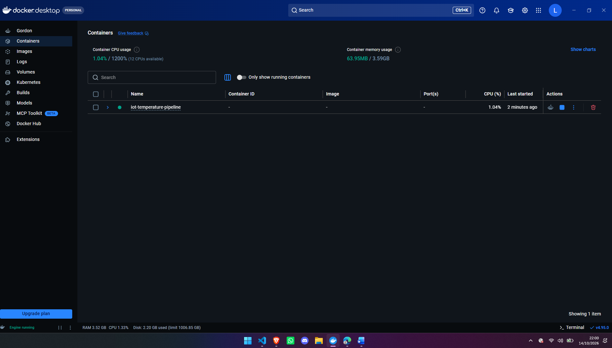
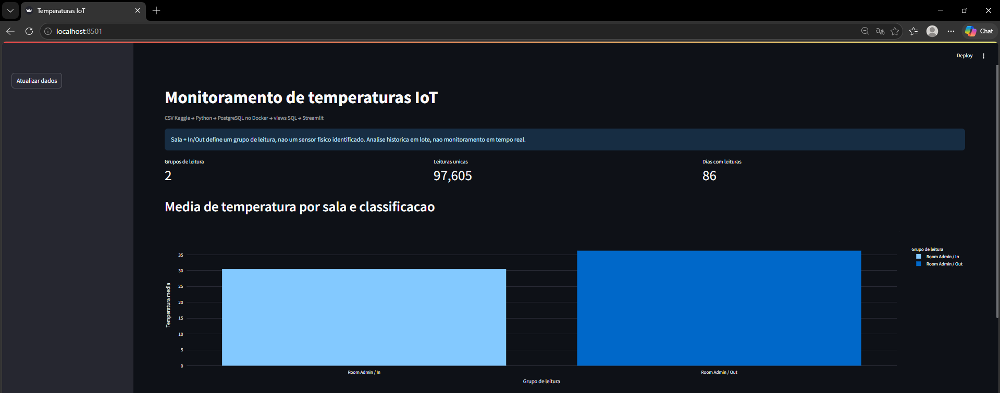
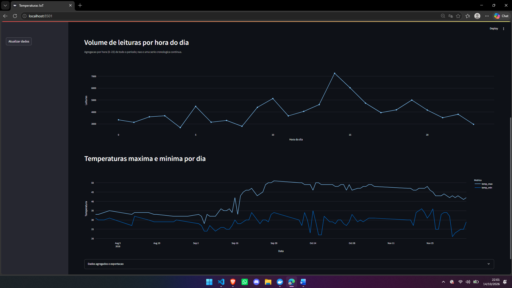
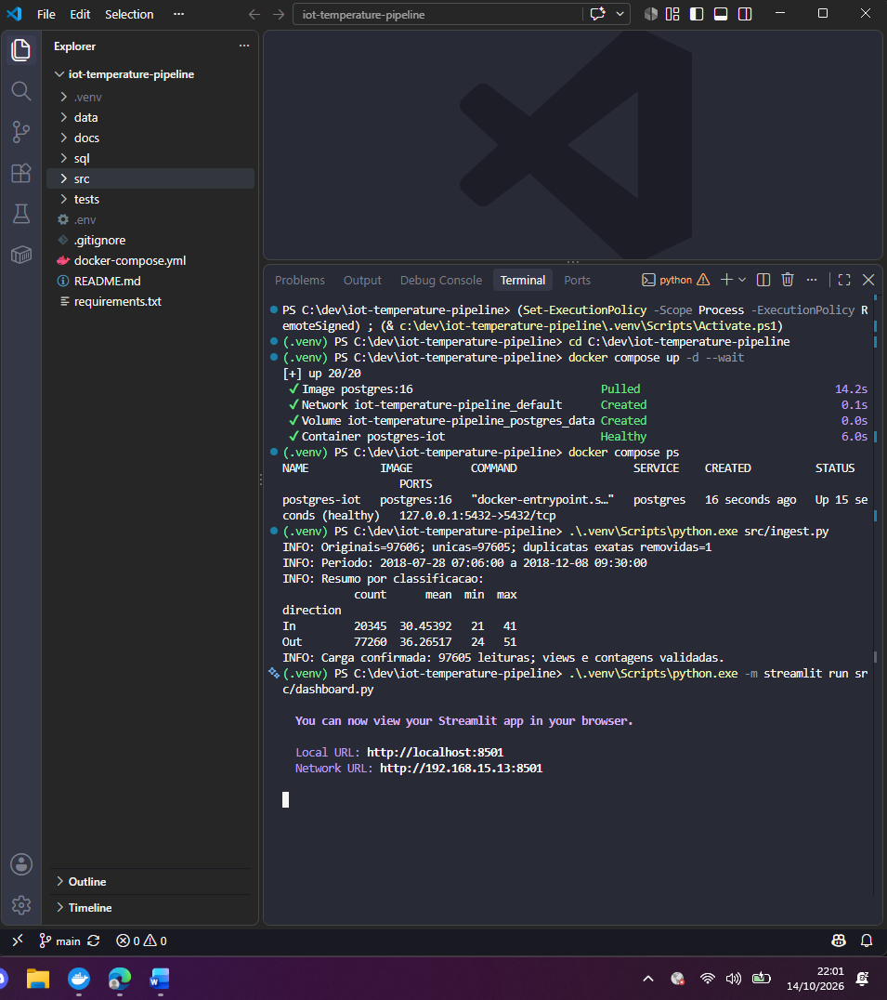
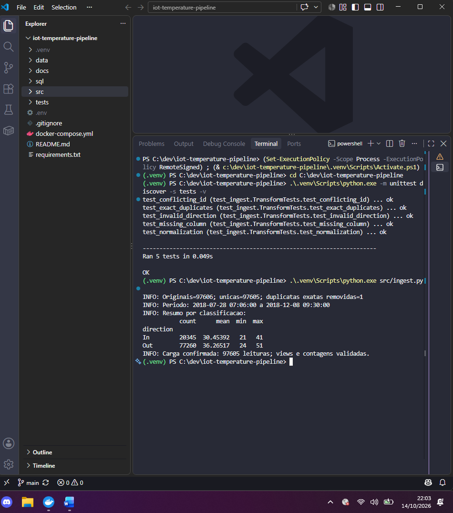

# Pipeline de temperaturas IoT

Projeto acadêmico de Disruptive Architectures: IoT, Big Data e IA. Processa leituras históricas em lote com Python, armazena no PostgreSQL 16 via Docker e apresenta três visualizações interativas com Streamlit e Plotly.

## Arquitetura e tecnologias

CSV Kaggle → pandas (validação e deduplicação) → SQLAlchemy/psycopg2 → PostgreSQL no Docker → três views SQL → Streamlit/Plotly. Git e GitHub registram a evolução do projeto.

```text
src/ingest.py           Validação, carga e criação das views
src/dashboard.py        Indicadores, gráficos e exportação
sql/views.sql           Três views analíticas
tests/test_ingest.py    Cinco testes unitários
data/                  CSV local, não versionado
docs/screenshots/       Evidências reais da execução
docs/validacao.md       Registro dos testes e da integração
docs/entrega.md         Checklist e roteiro do vídeo
.env.example            Modelo público sem senha real
```

## Dataset e significado das colunas

Fonte: [Temperature Readings: IoT Devices — atulanandjha](https://www.kaggle.com/datasets/atulanandjha/temperature-readings-iot-devices). Baixe o CSV para data/IOT-temp.csv. O link disponibiliza a fonte sem redistribuir a base; observe os termos do Kaggle antes de republicar os dados.

| CSV original | Banco | Significado |
|---|---|---|
| id | source_id | Identificador da leitura |
| room_id/id | room | Sala/local informado |
| noted_date | reading_at | Data e hora, interpretadas como dia-mês-ano hora:minuto |
| temp | temperature | Valor numérico de temperatura |
| out/in | direction | Classificação In/Out |
| Derivado | device_id | Sala + classificação, não ID físico de sensor |

Os dois grupos não comprovam dois sensores físicos. Não se atribui fuso horário não informado. Trata-se de processamento histórico em lote, sem streaming, modelo de IA ou ligação com sensores em tempo real; esses componentes não são exigidos neste desafio prático.

## Pré-requisitos

Python 3.11 ou 3.12, Git e Docker Desktop com mecanismo Linux ativo. No Windows, configure o WSL 2 caso seja o backend escolhido. Confira docker info: a seção Server precisa responder sem erro.

## Configuração e execução no Windows / PowerShell

```powershell
git clone https://github.com/lucasouqueiroz/iot-temperature-pipeline.git
cd iot-temperature-pipeline
python -m venv .venv
.\.venv\Scripts\python.exe -m pip install -r requirements.txt
if (-not (Test-Path .env)) { Copy-Item .env.example .env }
```

Se já clonou, salve suas alterações e use git pull --ff-only em vez de clonar novamente. Abra o arquivo .env na raiz e preencha POSTGRES_PASSWORD com uma senha local antes da primeira criação do banco. Não é a senha do GitHub. Mantenha os demais valores do modelo para a configuração padrão e nunca publique o .env.

Com o CSV em data/IOT-temp.csv e Docker Desktop aberto, execute cada comando após o anterior concluir com sucesso:

```powershell
.\.venv\Scripts\python.exe -m unittest discover -s tests -v
.\.venv\Scripts\python.exe src/ingest.py --validate-only
docker compose up -d --wait
docker compose ps
.\.venv\Scripts\python.exe src/ingest.py
.\.venv\Scripts\python.exe -m streamlit run src/dashboard.py
```

Abra http://localhost:8501. Os comandos usam diretamente o venv e dispensam alteração da política de execução do PowerShell. No Linux/macOS, use .venv/bin/python e copie o modelo com cp .env.example .env, somente se .env não existir.

## Qualidade, persistência e segurança

A ingestão rejeita colunas ausentes, campos nulos/vazios, datas inválidas, temperaturas não finitas, classificações fora de In/Out e IDs conflitantes. Remove apenas duplicatas exatas, sem imputação ou exclusão arbitrária de extremos.

ATENÇÃO: a carga substitui integralmente temperature_readings no banco dedicado ao projeto. DELETE, inserção, criação das views e conferência de contagens ocorrem na mesma transação. Não aponte para um banco de produção. source_id tem índice único; reading_at tem índice para consultas; um bloqueio transacional serializa cargas. Falhas dentro da transação revertem as alterações pelo mecanismo transacional. Não foi realizado teste de injeção de falha para demonstrar rollback experimentalmente.

O volume Docker mantém os dados ao parar o serviço. A porta PostgreSQL é publicada somente na interface local. Credenciais ficam no .env ignorado pelo Git.

## Views SQL e visualizações

O SQL completo está em [sql/views.sql](sql/views.sql).

1. avg_temp_por_dispositivo: GROUP BY device_id, AVG(temperature) arredondada a duas casas e COUNT(*). Compara média e quantidade por grupo sala/classificação. O nome técnico não deve ser interpretado como identificação física de sensores.
2. leituras_por_hora: EXTRACT(HOUR FROM reading_at) e COUNT(*), agregando todo o período por hora do dia, de 0 a 23. Mede volume de coleta, não temperatura nem taxa de falhas.
3. temp_max_min_por_dia: DATE(reading_at), MAX e MIN, fornecendo extremos diários combinando os grupos. A linha conecta dias observados e não comprova coleta contínua entre eles.

A ingestão confere o total da tabela e as somas das duas primeiras views antes de confirmar a transação. Não calcule a média geral como média simples das médias de grupos de tamanhos diferentes.

## Resultados e insights

Execução local de 14/10/2026, comprovada por logs e capturas fornecidos pelo aluno:

- Registros originais: 97.606; duplicata exata removida: uma; leituras únicas: 97.605.
- Período: 28/07/2018 07:06 a 08/12/2018 09:30.
- Dashboard: dois grupos e 86 dias com registros, não necessariamente consecutivos.

| Classificação | Leituras | Média aproximada | Mínimo | Máximo |
|---|---:|---:|---:|---:|
| In | 20.345 | 30,45392 | 21 | 41 |
| Out | 77.260 | 36,26517 | 24 | 51 |

A diferença entre médias é aproximadamente 5,81. A comparação é descritiva, não pareada por instante: horários e volumes podem diferir. Não comprova causalidade. Os extremos e as diferenças entre grupos podem orientar investigações e alertas, cujos limites dependem do contexto operacional. Menor volume por hora, isoladamente, não prova falha de coleta.

## Validação e evidências

PostgreSQL 16 saudável; carga confirmada; contagens verificadas pelo script; cinco testes unitários aprovados; segunda carga manteve 97.605 leituras; indicadores e três gráficos renderizados. O registro detalhado está em [docs/validacao.md](docs/validacao.md). Não foram executados testes de carga, concorrência ou injeção de falhas.

### Docker Desktop



### Indicadores e médias por grupo



### Volume por hora e extremos diários



### Carga e inicialização do dashboard



### Testes unitários e recarga



## Diagnóstico e operação

- docker não reconhecido: instale Docker Desktop ou reabra o terminal após a instalação.
- Cliente responde e Server falha: inicie Docker Desktop e resolva mensagens do backend WSL antes do Compose.
- POSTGRES_PASSWORD ausente: salve .env na raiz e reinicie o Streamlit.
- Senha alterada com volume existente: editar .env não altera a senha já gravada no banco; use a original ou altere-a via SQL. Não apague volumes sem aceitar a perda de dados.
- Banco indisponível: docker compose ps e docker compose logs postgres.
- Porta ocupada: ajuste POSTGRES_PORT no .env e recrie o serviço.
- Parar preservando o volume: docker compose down.
- Após recarga: clique em Atualizar dados no dashboard.

## Git e autoria

```powershell
git status
git add README.md docs
git diff --cached --stat
git commit -m "Adiciona evidencias da validacao local"
git push origin main
git pull --ff-only
```

O repositório foi criado remotamente e clonado. git init inicia um repositório novo e não precisa ser executado novamente neste clone. Verifique user.name e user.email antes dos commits. Não force a inclusão de .env, .venv ou CSV. Documente somente comandos e resultados efetivamente realizados.

## Entrega acadêmica

Código e evidências estão publicados. O PDF final e o vídeo de até quatro minutos ainda precisam ser concluídos. Consulte [docs/entrega.md](docs/entrega.md). Os links finais devem ser conferidos antes do envio; este repositório não garante uma nota específica.
